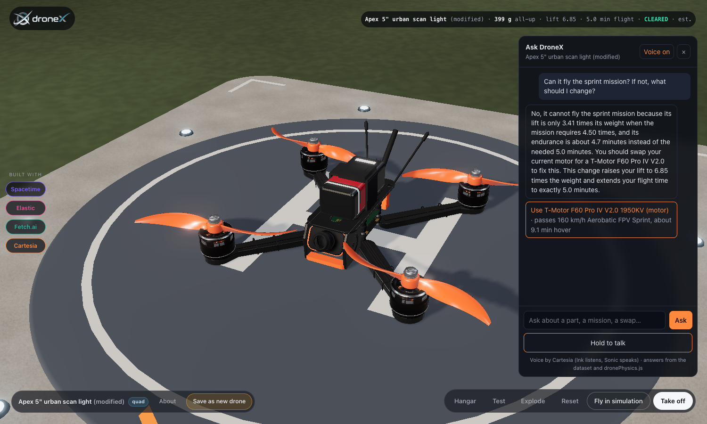
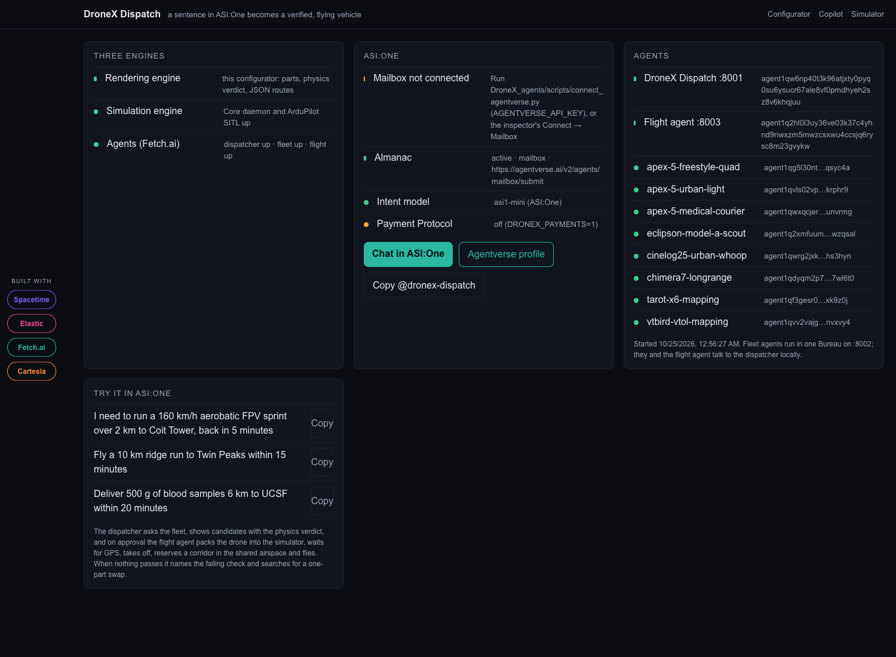

<div align="center">

<picture>
  <source media="(prefers-color-scheme: dark)" srcset="docs/images/brand/dronex-logo-light.png">
  
</picture>

<h3>Design a drone from real parts. Know it flies before you print it. Then fly it over a real city.</h3>

<p>
  
  
  
  
  <br>
  
  
  
  
</p>

<p>
  <a href="#what-you-can-do">Features</a> ·
  <a href="#try-it-a-two-minute-demo-that-really-works">Demo</a> ·
  <a href="#how-it-works">Architecture</a> ·
  <a href="#run-it">Run it</a> ·
  <a href="docs/DEPLOY.md">Deploy</a> ·
  <a href="#documentation">Docs</a>
</p>

</div>

---

DroneX is a drone configurator and a flight simulator joined into one flow. You build a drone part by part from
sourced, real-world components; physics in code (never a language model) tells you whether it can fly a mission;
an assistant you can talk to explains every part and suggests the swap that fixes a failing check; and one
button puts that exact drone in the air on ArduPilot's own flight code over photorealistic 3D tiles of San
Francisco, with solid buildings in its way.



---

## What you can do

| | |
|---|---|
| **Build** | Pick a real drone from the Hangar (8 presets, from a 5-inch freestyle quad to a VTOL mapper), build it part by part in 3D, explode it, click any part to see what it does and where every number comes from. |
| **Ask** | **Ask DroneX** (top right): hold to talk or type. "What does this battery do?", "Why does it fail the medical mission?", "What should I change?". The answer is spoken, every number in it comes from the dataset or the physics, and a swap the physics has passed comes back as a button that changes the drone. |
| **Test** | Swap motors, propellers, batteries, payloads and airframes with compatibility checks, then test against six missions (sub-250 g urban scan, 15 km medical delivery, 40 min search and rescue, 160 km/h sprint, 10 km long-range, crop survey). Pass or fail per requirement, with the reason. |
| **Fly** | **Fly in simulation** sends the exact drone to the simulator: its battery, hover throttle and airspeeds become ArduPilot parameters, its 3D model flies on the map. Arm, take off, go to a landmark, fly a mission. |
| **Talk to it in the air** | The **Copilot** page (`/copilot`): spoken commands ("take off to thirty metres") and spoken callouts (GPS, arming, altitude bands, battery), beside a live map of the shared airspace. |
| **Run the track scenarios** | **Scenarios** (`/scenarios`): one runnable story per technology, each a real mission in the simulator. Two operators' crossing corridors refused and re-granted by SpacetimeDB; a flight investigated in Elastic; a patrol flown by voice through Cartesia; a clinic's request dispatched by the Fetch.ai agents. The missions also sit in the simulator's plan library. |
| **Dispatch from ASI:One** | **DroneX Dispatch**: say the job in ASI:One ("run a 160 km/h sprint over 2 km, back in 5 minutes"); agents find a hangar drone that passes, show the verdict, and on approval fly it in the simulator. |

## The track scenarios

Each sponsor technology gets a story where it does the job it is best at, run against the real engines from
`/scenarios` (about 3–4 minutes each, all four checked end to end):

| Track | Scenario | What it shows |
|---|---|---|
| SpacetimeDB | **Two operators, one sky.** A UCSF courier holds a 75–95 m corridor over Mission Bay; a survey hexacopter asks to cross it in the same band and the reducer refuses ("climb above 105 m"); it asks at 110–130 m, is granted, and both fly their missions. | Rules enforced next to the data, atomically, seen live by every client. |
| Elastic | **After the flight, find the signal.** The courier flies Mission Bay → Pier 40 and back; ES\|QL over the telemetry finds a drain of about 11.5 %/min, which projects 8.7–8.9 min, within 0.1 min of the configurator's 8.8 min mixed-flying estimate; Jina semantic search over the 5,799-parameter manual answers "low battery failsafe action" with `BATT_FS_LOW_ACT`. | Design, flight and documentation in one cluster. |
| Cartesia | **Hands on the sticks.** A patrol along the Embarcadero flown by voice: Sonic speaks each command, Ink hears it ("Take off to 30 meters"), the copilot acts, and the callouts (motors armed, airborne, mission leg two) are spoken as they fire. | Voice as the interface when hands and eyes are busy. |
| Fetch.ai | **A clinic asks, the fleet answers.** A request through the dispatcher's Agentverse mailbox; the fleet agents answer from their verdicts, and the flight agent waits for GPS, reserves a corridor and flies. | Agents doing real, verifiable work. |

## Try it: a two-minute demo that really works

1. Open `http://localhost:3000/?build=apex-5-urban-light` and press **Build all**.
2. Press **Test** and choose **FPV sprint** (or ask the assistant to "switch to the sprint mission"). The HUD
   says it does not pass.
3. Open **Ask DroneX** and ask (or hold to talk): *"Can it fly the sprint mission? If not, what should I change?"*
   It answers that lift is 3.41× the weight where the mission needs 4.50×, and endurance is 4.7 of 5.0 minutes,
   and offers **Use T-Motor F60 Pro IV V2.0**.
4. Press the button. The motors swap on the pad and the HUD reads **CLEARED**: lift 6.85×, 5.0 minutes.
5. Ask *"What does the motor do?"* to hear why: KV, rpm per volt, propeller size, weight per arm.
6. Press **Fly in simulation**. The same drone appears on a San Francisco pier. Open `/copilot`, hold to talk:
   *"Take off to thirty metres."* Then *"Go to Coit Tower."*

Every figure above was produced by `dronePhysics.js` over the parts dataset; the assistant only says them.

---

## Why

Anyone with a 3D printer, an ArduPilot flight controller and a weekend can build a working drone: a clinic's
courier, a farm's mapper, a town's fire-watch. But printing is slow and failure is expensive. A frame takes hours
to print and a day to finish; if the motor is too weak for the propeller or the battery too heavy for the frame,
you find out at the first hover, with the aircraft on its back in the grass. A wrong printed part is scrap. The
numbers you need are scattered across datasheets or made up by online calculators, and the design and the flight
live in different tools.

DroneX closes that loop with no printing in between: real parts with sources, a deterministic verdict, an
assistant that explains it in plain words, and a simulator that flies *your* drone, not a stand-in, between real
buildings. Iterate in minutes, print once.

## How it works

```
                          ┌──────────────────────────── DroneX_render (Next.js + three.js) ──────────────────────────┐
  builder ──voice/text──▶ │  configurator  ◀─ dronex:state / dronex:swap ─▶  Ask DroneX (Cartesia Ink in, Sonic out)  │
                          │      │ parts dataset + dronePhysics.js (the verdict)        │ /api/assistant: tools over    │
                          │      │                                                       │ the dataset and the physics   │
                          │      └── Fly in simulation ──┐          /copilot: voice flight copilot + live airspace       │
                          └───────────────────────────────┼──────────────────────────────────────────────────────────────┘
                                                          │ JSON-RPC over a local unix socket
  ASI:One user                                            ▼
      │  Agent Chat Protocol          ┌──────── dronex/DroneX_1 (simulation engine) ─────────┐
      ▼                               │  Core daemon (Rust) · ArduPilot SITL · Cesium 3D map │
  DroneX_agents (Fetch.ai uAgents)    │  solid buildings from OpenStreetMap                  │
  dispatcher · 8 fleet agents · ──────▶└──────────────────────────────┬───────────────────────┘
  flight agent (via configurator API)                                 │ telemetry
                                                    DroneX_live: mirror ──▶ SpacetimeDB (shared airspace, corridors)
                                                                       └──▶ Elastic (flight analytics)
```

| Folder | What it is |
|---|---|
| [`DroneX_render/`](DroneX_render/) | The configurator, Ask DroneX, the Copilot and Dispatch pages, and the JSON API the other pieces use (Next.js 16, three.js). The parts dataset and the physics live in `prototype/drone-assembly/src/`. |
| [`dronex/DroneX_1/`](dronex/DroneX_1/) | The simulation engine: a fork of UXDuck Core (Rust daemon, ArduPilot SITL, web UI over Cesium 3D tiles) with our account backend and solid buildings. `dronex/uxduck-core/` is the untouched upstream, for diffing. |
| [`DroneX_live/`](DroneX_live/) | Mirrors every simulated vehicle into the **SpacetimeDB** shared airspace (corridor reservations and separation enforced in reducers) and the **Elastic** flight index. |
| [`DroneX_agents/`](DroneX_agents/) | **DroneX Dispatch** on Fetch.ai: a dispatcher on Agentverse, one fleet agent per hangar drone, and a flight agent that waits for GPS, takes off, reserves a corridor and flies. Payment Protocol on testnet. |



### The rule everything follows

**Code decides; models explain.** Whether a drone flies a mission is computed by `dronePhysics.js` from sourced
part records; every computed number is labelled *est.*; unknown values stay `TODO(source)` instead of being
guessed. The assistant, the copilot and the agents call tools that return those numbers and only put them into
words. A swap is offered only after the physics has judged it.

## Built with

| Technology | What it does in DroneX | Where |
|---|---|---|
| **Cartesia** (Sonic TTS, Ink STT) | The voice of DroneX: Ask DroneX on the configurator (explain parts and missions, suggest swaps) and the flight copilot on `/copilot` (commands in, callouts out, barge-in). | `DroneX_render/src/components/assistant/`, `src/lib/ai/assistant.ts`, `src/components/copilot/` |
| **Fetch.ai** (uAgents, Agentverse, ASI:One) | DroneX Dispatch: a sentence in ASI:One becomes a verified, flying vehicle; Interactive Cards; Payment Protocol with testnet FET checked on chain. The ASI:One model also parses intent. | `DroneX_agents/`, `DroneX_render/src/app/dispatch/` |
| **SpacetimeDB** | The shared, persistent airspace: every vehicle, position, corridor and incident in tables; corridor grants and separation are reducers. | `DroneX_live/`, `DroneX_render/src/components/airspace/` |
| **Elastic** | Flight analytics: fixes, events and verdicts indexed; ArduPilot's parameter manual and the physics notes as semantic text with Jina embeddings (measured best of six setups on this data: [results](DroneX_live/elastic/README.md#which-embedding-model-measured)); an agent that finds the signal. | `DroneX_live/elastic/` |
| **ArduPilot SITL** | The real flight code, in software in the loop. | `dronex/DroneX_1/` |

Every screen has a **Built with** sidebar saying exactly what each technology does on that screen and in which
file (`DroneX_render/src/lib/tracks.ts`). Why each was chosen, and what was assessed and set aside:
[docs/INTEGRATIONS.md](docs/INTEGRATIONS.md).

---

## Run it

### Prerequisites

- macOS or Linux, Node 24.11+, Rust (rustup), openssl
- Python 3.11 and [uv](https://docs.astral.sh/uv/) for the agents (optional)
- The SpacetimeDB CLI for the shared airspace (optional), an Elastic Cloud Serverless project for analytics (optional)

### Install (once)

```sh
(cd dronex/DroneX_1/backend && npm install)
(cd DroneX_render && npm install)
(cd DroneX_live && npm install)
uv venv --python python3.11 DroneX_agents/.venv
uv pip install --python DroneX_agents/.venv/bin/python -r DroneX_agents/requirements.txt

cp DroneX_render/.env.example DroneX_render/.env.local   # then fill in the keys you have
```

The ArduPilot SITL builds live in `dronex/DroneX_1/.dev/core-data/simulators/`;
`dronex/DroneX_1/scripts/build-sitl.sh copter plane` builds them from ArduPilot's source.

### Start everything

```sh
./dev.sh                  # simulator, configurator, live layer, agents
NO_AGENTS=1 ./dev.sh      # without the Fetch.ai agents
NO_LIVE=1 ./dev.sh        # without the SpacetimeDB / Elastic mirror
```

| Open | URL |
|---|---|
| Configurator + Ask DroneX | http://localhost:3000 |
| Voice flight copilot + live airspace | http://localhost:3000/copilot |
| DroneX Dispatch status | http://localhost:3000/dispatch |
| Track scenarios | http://localhost:3000/scenarios |
| Simulator | http://127.0.0.1:45010 |

The first time, the simulator page shows a pairing code; approve it with
`UXDUCK_DATA_DIR=dronex/DroneX_1/.dev/core-data dronex/DroneX_1/core/target/debug/uxduck rpc call pairing/approve --json '{"code":"<code>"}'`.
It is served as immutable, so hard-reload it once after the first run.

### Keys (`DroneX_render/.env.local`)

Every process reads this one file. Pieces whose keys are missing say so and stay off; the rest runs.

| Key | Needed for |
|---|---|
| `INTENT_API_KEY` (+ `INTENT_API_BASE`, `INTENT_MODEL`) | Ask DroneX, the copilot's commands, the dispatcher's intent parsing. ASI:One by default ([asi1.ai](https://asi1.ai/dashboard/api-keys)); any OpenAI-compatible endpoint works. |
| `CARTESIA_API_KEY` (+ `CARTESIA_VOICE_ID`, `CARTESIA_TTS_MODEL`, `CARTESIA_STT_MODEL`) | Voice in and out. Without it, Ask DroneX and the copilot still work by typing. |
| `SPACETIME_URI`, `SPACETIME_DB`, `NEXT_PUBLIC_SPACETIME_*` | The shared airspace ([DroneX_live/README.md](DroneX_live/README.md)). |
| `ELASTIC_URL`, `ELASTIC_API_KEY`, `ELASTIC_INDEX_PREFIX` | Flight analytics ([DroneX_live/elastic/README.md](DroneX_live/elastic/README.md)). |
| `DRONEX_*_SEED`, `AGENTVERSE_API_KEY`, `DRONEX_PAYMENTS*` | The Fetch.ai agents: stable addresses, the Agentverse mailbox, the Payment Protocol ([DroneX_agents/README.md](DroneX_agents/README.md)). |

Keys are read on the server only; the browser gets short-lived Cartesia tokens.

## Tests

```sh
cd DroneX_render && npm run typecheck && npm run lint && npm test     # 64 tests: physics, assistant tools, callouts...
node DroneX_render/prototype/drone-assembly/scripts/check-drone-physics.mjs   # the physics against every preset
DroneX_agents/.venv/bin/python -m pytest DroneX_agents                 # 35 tests: cards, missions, flight sequence, payments
```


## Documentation

- [`DroneX_render/docs/SPEC.md`](DroneX_render/docs/SPEC.md): what the product does
- [`DroneX_render/docs/ARCHITECTURE.md`](DroneX_render/docs/ARCHITECTURE.md): where things live
- [`DroneX_render/docs/ROADMAP.md`](DroneX_render/docs/ROADMAP.md): phases, and what is in the current one
- [`DroneX_agents/README.md`](DroneX_agents/README.md): DroneX Dispatch, pairing with Agentverse, testing through ASI:One
- [`DroneX_live/README.md`](DroneX_live/README.md): the shared airspace and the analytics
- [`docs/TRACKS.md`](docs/TRACKS.md): the four technologies, one page each: the problem, what DroneX does with it, the moment to watch, and what would be missing without it
- [`docs/INTEGRATIONS.md`](docs/INTEGRATIONS.md): every technology considered, what was chosen and why, and what testing found
- [`docs/DEPLOY.md`](docs/DEPLOY.md): the plan for taking DroneX live on a public URL

### How the configurator and the simulator connect

`DroneX_render/src/lib/sim/` talks to Core over its local unix socket (JSON-RPC, same user, no pairing):
`sim/start`, `vehicle/save`, `vehicle/size`, `vehicle/bookmarks`, `param/set`. The model and design sent are kept
in `DroneX_render/.dronex/sim/<id>/` and served at `/api/sim/designs/<id>/model.glb`; the vehicle's "DroneX
model" bookmark points there, and `dronex/DroneX_1/scripts/patch-interface-dronex.mjs` teaches the simulation UI
to draw it (idempotent; `git checkout -- interface/` undoes it).
